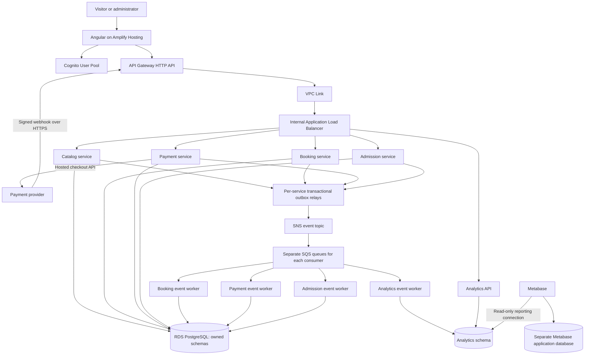

# Wonderland: Python development and viva guide

Prepared from the four-page SE6020 Cloud Computing assignment supplied by the student. This is a development guide, not the assessed report or a completed implementation. Updated for the user-selected Angular frontend; the implementation status is tracked in docs/REQUIREMENTS.md. Requirements below come from the brief; architecture, service boundaries, capacities, timing targets, and implementation policies are recommendations unless explicitly described as required.

## 1. What you must deliver

Build a cloud-native theme park website where visitors discover attractions, book one ticket tier for a chosen date and time slot, pay, receive a digital ticket, and see booking and visit history. Administrators manage attractions and pricing and analyse actual park activity.

The application must include Python microservices, container images, deployment to Kubernetes, an API Gateway, a web interface, managed authentication, persistent data, a connected visualization platform, infrastructure automation, and a real GitHub repository.

The brief permits another cloud and equivalent managed authentication, but the rubric explicitly names AWS Amplify and Cognito. AWS is the least ambiguous choice for this project. Do not substitute an entirely serverless Lambda application for the required containerized Kubernetes deployment.

| Assessed component | Marks | Evidence to prepare |
|---|---:|---|
| Solution report | 15 | Requirements, diagrams, design decisions, patterns, security, deployment, tests, cost discussion |
| Microservices | 20 | Separate running Python services with meaningful ownership and working APIs |
| Kubernetes with API Gateway | 20 | EKS workloads reached through API Gateway; routing and recovery demonstration |
| Web interface, Amplify, Cognito | 15 | Hosted Angular UI, signup/login, visitor and administrator workflows |
| Monitoring and visualization | 10 | Stored timestamped events connected to Metabase, Superset, or Power BI |
| Infrastructure as Code | 10 | Versioned Terraform or CloudFormation and reproducible cloud setup |
| Integration demonstration | 10 | Complete visitor-to-dashboard flow and GitHub integration |

Submission: report softcopy to Moodle; source code and other artifacts as links; demonstrable solution at the viva. The assignment is individual and worth 40% of the module. The brief requires acknowledging help provided to another student, including their index number and the type of help. Understand and cite adapted material and comply with your institution's rules on assistance.

Dates printed in the brief: released 16 August 2026; submission 11 October 2026; viva 8 November 2026. As of 15 October, the printed submission date has passed. Confirm any extension or late-submission arrangement with the lecturer. This guide does not assume one exists. The brief says inability to attend the viva must be communicated one week beforehand.

## 2. Scope: build these features first

### Visitor functionality

- Sign up, verify account where configured, log in, log out, and recover access through managed authentication.
- Browse active attractions with name, description, category, thrill level, age guidance, and height guidance.
- Select exactly one tier, actual guest count, visit date, and available time slot.
- Review the server-calculated total and pay through a hosted payment integration.
- See payment/confirmation progress, booking reference, and digital tickets.
- View their own bookings and actual visit/check-in history.

### Administrator functionality

- Create and update attractions; retire an attraction without deleting its historical usage.
- Create/update/disable ticket tiers and pricing stored in the database.
- Record gate admissions and ride usage using a simple staff page.
- Monitor actual arrivals, purchases by tier, revenue by tier, popular attractions, and hourly activity.
- Access the connected BI dashboard through an authenticated admin workflow.

Gate and ride recording are necessary supporting workflows: analytics cannot infer physical arrivals or ride usage from a booking alone. For the assignment, an authenticated administrator page can simulate a gate terminal and ride operator. Physical scanners and IoT hardware are not required by the brief.

### Initial pricing policy

| Tier | Guest rule | Total price | Store as USD cents |
|---|---|---:|---:|
| Individual | Exactly 1 | $40 | 4000 |
| Couple | Exactly 2 | $75 | 7500 |
| Family | 1 through 4 | $140 | 14000 |
| Group | 1 through 5 | $165 | 16500 |

The first two rules and upper limits reflect the brief; minimum sizes for Family and Group are a policy choice because the brief says "up to." You may instead choose minimums of 3 and 4, but record that decision. These are package prices, not per-guest prices. A Family booking with three guests still costs $140 under this policy. The stated $35 effective price applies to a full four-person family package.

Store actual guest count, total amount, currency, tier identity, and pricing version on every booking. A later price change must not change old bookings. Leave adult/child rates, promotions, refunds initiated by customers, reserved ride seats, and dynamic pricing until the required flow is complete. An operational compensation refund for a failed paid booking is a separate reliability concern.

## 3. Recommended technology stack

| Layer | Choice | Purpose |
|---|---|---|
| Backend | Python + FastAPI + Uvicorn | Typed APIs and generated OpenAPI documentation |
| Validation | Pydantic | Validate bodies and responses |
| Persistence | SQLAlchemy + Alembic + psycopg | Database access and repeatable migrations |
| Managed database | Amazon RDS PostgreSQL | Transactions, constraints, SQL reporting |
| Frontend | Angular + TypeScript + Angular CLI | Visitor/admin browser interface |
| Frontend hosting/auth client | AWS Amplify Hosting + Amplify libraries | Git-connected frontend delivery and Cognito integration |
| Identity | Amazon Cognito User Pool | Managed accounts and tokens |
| Containers | Docker + Amazon ECR | Build and store service images |
| Compute | Amazon EKS managed node group | Run containerized microservices on Kubernetes |
| API entry | API Gateway HTTP API + VPC Link + internal ALB | Authenticated entry and routing into EKS |
| Events | SNS topic + separate SQS consumer queues + DLQs | Fan-out, buffering, retry, consumer isolation |
| Analytics | Python consumer + PostgreSQL analytics schema + Metabase | Durable events and business dashboards |
| Infrastructure | Terraform | Reproducible AWS resources |
| CI/CD | GitHub Actions | Checks, image publication, deployment |
| Operations | Structured logs and CloudWatch | Troubleshooting and service/queue alarms |

Use current supported releases that work together, then pin the tested versions and image digests. Do not independently choose the newest version of every component without testing compatibility. Python 3.12 is a reasonable starting baseline if supported by your selected packages; the exact version is your implementation choice.

FastAPI supplies the APIs, not the whole browser application. Python is the main backend language; Angular/TypeScript satisfies the frontend part of the brief.

## 4. Architecture and service ownership



All application service workloads and their workers run in EKS. The shared RDS instance shown here is a budget compromise, not a requirement for microservices. Use separate schemas and database users, with no cross-service table writes or runtime cross-schema joins. Prefer separate databases on that instance if you want stronger permission boundaries. A shared RDS failure still affects multiple services; a claim of complete fault isolation would be inaccurate.

### Five service boundaries

| Service | Owns | Important responsibilities |
|---|---|---|
| Catalog | Attractions, tiers, prices | Attraction CRUD, retirement, pricing versions, catalog-change events |
| Booking | Visitor application profile, booking, slot inventory, issued tickets | Ownership, capacity, quote snapshots, confirmation, booking history |
| Payment | Checkout sessions, payment records, provider callbacks | Trusted checkout amount, signature verification, reconciliation, payment events |
| Admission | Ticket entitlement projection, check-ins, ride usage | Validate tickets locally, prevent repeated admission, record physical activity |
| Analytics | Event facts and reporting views | Deduplicate events, serve admin summary APIs, supply BI datasets |

You do not need a custom password/authentication microservice. Cognito owns credentials. A small application profile stored by Booking can hold display name and other assignment-specific preferences, keyed by Cognito `sub`. Administrators are Cognito users with an administrator group; they do not self-select an administrator role during signup.

A service can use one image with separate commands for its API, event consumer, and outbox relay, deployed as separate Kubernetes Deployments. They share that service's schema, but have independent execution and scaling. Avoid putting an uncoordinated forever-loop worker inside every API process.

### Avoid synchronous chains

Booking maintains a local projection of published tier/pricing data. Admission maintains its own projection of confirmed tickets. Analytics consumes events. Consequently, browsing, creating a pending booking, and scanning an already synchronized ticket do not need to synchronously call Analytics or each other.

Define a bounded pricing policy, for example: accept the last known active price for up to five minutes during a Catalog outage, and refuse new quotes after that bound. Existing accepted quotes remain valid until their expiry. Publish an initial pricing snapshot and detect missing version sequences; do not assume a new consumer can reconstruct current prices from events that predate its queue.

## 5. Data model

Use UUIDs or similarly unguessable identifiers, UTC `timestamptz` timestamps, integer minor currency units, and explicit status fields. Set the park's display/reporting timezone as configuration; use `Asia/Colombo` for a Sri Lankan demo park.

### Catalog schema

```text
attractions
  id, name, description, category, thrill_level,
  min_age, min_height_cm, guidance_text,
  status [ACTIVE, RETIRED], image_url, created_at, updated_at

ticket_tiers
  id, code, name, min_guests, max_guests, active

ticket_prices
  id, tier_id, amount_minor, currency,
  version, valid_from, valid_until, active
```

Only one applicable active price per tier/time range. Validate this in database constraints where practical and in the administrator update transaction. Retiring a tier blocks new quotes but preserves historical bookings.

### Booking schema

```text
profiles
  user_sub, display_name, created_at, updated_at

pricing_projection
  tier_id, tier_code, min_guests, max_guests,
  amount_minor, currency, price_version, active, last_synced_at

visit_slots
  id, visit_date, starts_at, ends_at, capacity_guests,
  held_guests, confirmed_guests, active

bookings
  id, reference, user_sub, tier_id, tier_code_snapshot,
  guest_count, slot_id, visit_date,
  amount_minor, currency, price_version,
  status, hold_expires_at, created_at, confirmed_at,
  idempotency_key, request_hash

tickets
  id, booking_id, guest_number, token_hash,
  status, valid_from, valid_until, created_at
```

Store the secure QR token in a recoverable encrypted form only if you need to redisplay it, or derive a carefully designed signed ticket. Hash-only storage alone cannot redisplay an opaque token. A practical option is encrypted token storage in Booking and only its hash in Admission. Do not put visitor email or payment information in QR contents.

### Payment schema

```text
checkout_requests
  booking_id, booking_version, user_sub, amount_minor, currency,
  hold_expires_at, request_status

payments
  id, booking_id, provider_session_id, provider_payment_id,
  amount_minor, currency, status, created_at, paid_at

provider_event_inbox
  provider_event_id [unique], received_at, processing_status
```

Keep a unique constraint on provider session ID and provider payment ID as applicable. A second event ID can describe the same underlying payment, so event-ID deduplication alone is insufficient.

### Admission schema

```text
ticket_entitlements
  ticket_id, booking_id, user_sub, token_hash,
  visit_date, valid_from, valid_until, state, source_version

gate_checkins
  id, ticket_id [unique for this no-reentry policy], booking_id,
  user_sub, checked_in_at, gate_id, staff_sub, request_id

ride_usage
  id, ticket_id, attraction_id, occurred_at,
  staff_sub, request_id [unique]

attraction_projection
  attraction_id, name, active, source_version
```

For the first version, one guest ticket admits one person once. A Family booking creates up to four guest tickets according to actual guest count. This supports separate arrivals and correct visitor counting. Re-entry policies are optional; they require a different admission uniqueness model.

### Analytics schema

```text
events
  event_id [primary key], event_type, schema_version,
  aggregate_id, aggregate_version, occurred_at, received_at,
  producer, correlation_id, payload_json

purchase_facts
  booking_id [unique], purchased_at, tier_code,
  guest_count, amount_minor, currency

arrival_facts
  checkin_id [unique], ticket_id, booking_id, user_sub,
  checked_in_at, gate_id

ride_usage_facts
  usage_id [unique], attraction_id, ticket_id, occurred_at
```

Add indexes on timestamp columns, user IDs used for history, slot lookups, token hashes, and reporting group keys. Keep SQL foreign keys within a service's data boundary. The analytics model may join its own projected facts and dimensions.

Every event-producing service also needs `outbox_events`; every consumer needs `processed_events` or equivalent inbox deduplication.

## 6. APIs to implement

Use `/api/v1` as the external prefix. Publish an OpenAPI specification per service. Successful creates normally return 201; asynchronous work may return 202; invalid transitions/full slots 409; missing authentication 401; insufficient permissions 403.

| Service | Example endpoints | Access |
|---|---|---|
| Catalog | `GET /attractions`, `GET /attractions/{id}`, `GET /ticket-tiers` | Public or authenticated browsing |
| Catalog | `POST /admin/attractions`, `PATCH /admin/attractions/{id}` | Administrator |
| Catalog | `POST /admin/ticket-tiers`, `PATCH /admin/ticket-tiers/{id}` | Administrator |
| Catalog | `POST /admin/ticket-tiers/{id}/prices` | Administrator |
| Booking | `GET /visit-slots?date=...` | Visitor |
| Booking | `POST /bookings` | Visitor, idempotency key required |
| Booking | `GET /bookings/me`, `GET /bookings/{id}` | Owning visitor |
| Booking | `GET /bookings/{id}/tickets` | Owning visitor |
| Booking | `GET /users/me`, `PATCH /users/me` | Current user |
| Booking | `POST /admin/visit-slots` | Administrator |
| Payment | `GET /payments/bookings/{booking_id}/checkout` | Owning visitor |
| Payment | `POST /payments/webhooks/provider` | Provider signature, no visitor JWT |
| Admission | `POST /admin/gate-checkins` | Administrator/staff |
| Admission | `POST /admin/ride-usage` | Administrator/staff |
| Admission | `GET /visits/me` | Owning visitor |
| Analytics | `GET /admin/analytics/summary?from=...&to=...` | Administrator |

Map these routes explicitly in the gateway and ALB. Do not assume a generic catch-all rule knows which service owns each path. Use path ownership or service prefixes consistently. Kubernetes health endpoints should be reachable by probes/target groups without visitor login and need not be exposed as public business APIs.

Example booking request:

```http
POST /api/v1/bookings
Authorization: Bearer <Cognito access token>
Idempotency-Key: <new UUID for this booking attempt>
Content-Type: application/json

{
  "tier_code": "FAMILY",
  "guest_count": 4,
  "visit_date": "2026-11-08",
  "slot_id": "<valid-slot-UUID>"
}
```

Do not accept `user_sub`, final price, booking status, payment success, or administrator role as client authority. Derive ownership from verified identity; derive price and allowed transitions on the server. If an idempotency key is reused with a different request body, return a conflict rather than silently returning the old result.

## 7. Booking, payment, and ticket flow

### Normal flow

1. Angular obtains a Cognito access token and loads tiers/slots.
2. Visitor submits a booking with actual guest count and an idempotency key.
3. Booking validates tier, guest limits, date/time, price version, and capacity.
4. In one database transaction, it reserves capacity, creates `PENDING_PAYMENT`, and inserts `BookingPaymentRequested` into its outbox.
5. Booking returns the booking reference and pending state. Angular polls the owner-protected checkout endpoint with a timeout and a clear pending message.
6. The Payment worker consumes `BookingPaymentRequested`, stores a trusted checkout request, and creates a hosted checkout session using a provider idempotency key derived from the booking/payment attempt. The amount comes from the trusted booking event, not the browser.
7. The checkout endpoint returns the hosted URL after session creation. Angular redirects the visitor there.
8. The payment provider calls the HTTPS webhook. Payment verifies the signature on the exact raw request body and persists the event/payment transition and outbox event transactionally.
9. A `PaymentSucceeded` event reaches Booking. Booking checks amount, currency, booking identity, and state, converts held capacity to confirmed capacity, generates one guest ticket per guest, and emits `BookingConfirmed`/ticket entitlement data in the same transaction.
10. Admission consumes the ticket data and creates its own entitlement records. Optionally publish an acknowledgement so Booking can display `gate_ready`; otherwise show synchronization status and measure the lag separately.
11. Angular's confirmation/history page reads the real server state. It must not mark a booking confirmed merely because the visitor reached a success URL.
12. Analytics consumes `BookingConfirmed` as the authoritative purchase fact, plus check-in and ride-use events later.

Using an event to request checkout avoids a mandatory live Booking-to-Payment call. It does add a short wait before a checkout URL appears. A Payment outage leaves new bookings pending and recoverable; it cannot allow new payments to complete while the payment integration itself is unavailable.

### State machines

```text
Booking:
PENDING_PAYMENT -> CONFIRMED
PENDING_PAYMENT -> EXPIRED
PENDING_PAYMENT -> PAYMENT_FAILED
Late/unfulfillable paid booking -> COMPENSATION_REQUIRED

Payment:
REQUESTED -> SESSION_CREATED -> SUCCEEDED
REQUESTED / SESSION_CREATED -> FAILED or EXPIRED
SUCCEEDED -> REFUND_PENDING -> REFUNDED  (compensation path)

Guest ticket:
ISSUED -> CHECKED_IN
ISSUED -> VOID
```

Treat cross-service copies of status as eventually consistent. Admission owns the authoritative check-in record; Booking does not directly write it. Show visit history through Admission or a consumer-maintained projection.

### Expiry and late payment

Choose a checkout method and provider expiry policy first, then align the booking hold with it; do not assume an arbitrary 10-minute hold is supported by every hosted checkout provider. For an initial card-only demo, a roughly 30-minute session/hold policy is a reasonable design to verify against the chosen integration.

An expiry worker coordinates with Payment to expire/reconcile the provider session. Never release inventory solely because the browser disappeared. Unknown provider state should trigger reconciliation rather than an assumption of failure. Serialize payment confirmation and expiry using booking/slot locks. If a valid paid event arrives after capacity was released, atomically reacquire capacity if available; otherwise mark compensation required, issue no usable ticket, and trigger an idempotent refund workflow or clearly documented operator recovery. Test this race.

### Capacity concurrency

Capacity is measured in guests, not package bookings. Use a transaction with a row lock or a conditional update such as:

```sql
UPDATE booking.visit_slots
SET held_guests = held_guests + :requested
WHERE id = :slot_id
  AND active = TRUE
  AND held_guests + confirmed_guests + :requested <= capacity_guests
RETURNING id;
```

No returned row means the slot cannot satisfy the request. The booking insertion, idempotency record, and outbox event must commit in the same transaction; otherwise roll back the hold. Add nonnegative counters and upper-bound constraints. Confirmation moves guest count from held to confirmed atomically. Retries and expiry must not subtract or add twice.

## 8. Gate admissions and ride usage

Use a random opaque token for each guest ticket. The QR encodes that token, or a URL that presents it to an authenticated staff workflow. A booking reference alone should not be a freely forgeable authorization credential.

Gate flow:

1. Administrator logs into the gate page and scans/pastes a token.
2. Admission hashes it and looks up its own entitlement projection.
3. Validate ticket state, visit date, and the documented arrival window.
4. Insert one gate check-in under a unique constraint and create its outbox event in one transaction.
5. Return success for the first scan. Repeated scans return an already-used result without incrementing arrivals.

Check-in remains available for previously synchronized tickets during a Booking, Catalog, Payment, or Analytics outage. Newly purchased tickets may not yet be available if synchronization is delayed: display this explicitly, retry, and monitor the event backlog. Do not claim instant cross-service consistency.

Ride flow:

1. Staff selects an active attraction and a guest ticket.
2. Admission verifies that the guest checked in and that the attraction projection is active.
3. Record a new ride usage with timestamp and request ID; write an outbox event atomically.
4. Repeating the same request ID is a retry and must not add a use. A later legitimate ride by the same ticket uses a new request ID and does count.

For browser QR scanning, retain a paste/manual-entry fallback so the viva is not dependent on camera access. Define whether the preferred slot is a strict admission window or a planning preference; the brief does not prescribe this policy.

## 9. Event delivery, outbox, and recovery

Example event envelope:

```json
{
  "event_id": "f972a094-2d22-4c7e-afc8-6d99063e6fd6",
  "event_type": "GateCheckInRecorded",
  "schema_version": 1,
  "aggregate_id": "<guest-ticket-id>",
  "aggregate_version": 2,
  "occurred_at": "2026-11-08T04:00:00Z",
  "producer": "admission-service",
  "correlation_id": "<booking-id>",
  "data": {
    "checkin_id": "<check-in-id>",
    "ticket_id": "<guest-ticket-id>",
    "booking_id": "<booking-id>",
    "gate_id": "MAIN"
  }
}
```

Key events: `PricingUpdated`, `AttractionUpdated`, `BookingPaymentRequested`, `PaymentSucceeded`, `PaymentFailed`, `BookingConfirmed`, `GateCheckInRecorded`, `RideUsageRecorded`, and compensation/refund events if implemented. Only include personal data needed by a specific consumer. Restrict queues carrying ticket material; do not place raw ticket tokens in generic logs or analytics facts.

Outbox procedure:

1. Business state and an outbox row are written in the same database transaction.
2. A relay claims committed outbox rows with locks/leases and publishes them to SNS.
3. Mark them delivered only after successful publication.
4. A crash after publish and before marking can cause redelivery: consumers must deduplicate.
5. A consumer records its processed event ID and fact/state change in one local transaction, then deletes the SQS message only after commit.

SNS fans events out to independent SQS queues. Do not put Booking, Admission, and Analytics on the same queue expecting each to receive every event; competing consumers on one queue divide work. Use one queue per logical consumer, with multiple replicas sharing that queue to scale that consumer. Configure subscription filters deliberately and test the filter location: message attributes versus body.

Use raw message delivery or explicitly parse the SNS envelope. Configure queue policies allowing the SNS topic to send, suitable visibility timeouts, retry backoff, and dead-letter queues. For long operations, extend visibility. Use long polling. Retain messages long enough for your intended recovery window.

Standard delivery may duplicate or reorder events. Use aggregate versions, idempotent transitions, and deferral/reconciliation for missing predecessors; use FIFO where ordering is needed and supported by the selected topology. FIFO does not remove the need for application-level idempotency after a crash. Persist facts so historical reports are not limited by queue retention.

Pattern to explain in the viva: the outbox prevents a database commit followed by a lost event. A plain `db.commit(); publish_event()` leaves a failure gap. See [AWS transactional outbox guidance](https://docs.aws.amazon.com/prescriptive-guidance/latest/cloud-design-patterns/transactional-outbox.html) and [SNS-to-SQS fan-out](https://docs.aws.amazon.com/sns/latest/dg/sns-sqs-as-subscriber.html).

## 10. Authentication and authorization

1. Terraform creates a Cognito User Pool, a browser app client without a client secret, and an `Administrators` group.
2. Angular configures Amplify against those exact Cognito resources. Do not accidentally create a second user pool through another tool.
3. Public signup creates visitors only. Provision administrator membership through a privileged administrative process.
4. Angular obtains an access token and sends it as `Authorization: Bearer ...`.
5. API Gateway validates the configured issuer/audience for protected routes. Services also validate tokens or consume a securely authenticated identity context; direct pod/internal routes must not bypass authorization.
6. Validate signature against cached/refreshable JWKS, allowed algorithm, issuer, expiry, `token_use=access`, and app `client_id`. Cognito ID and access tokens have different claims; do not confuse ID-token `aud` with access-token `client_id`.
7. Enforce `cognito:groups` for administrator operations and enforce `sub` ownership for visitor bookings/history. Hiding a button is not access control.
8. Reject a visitor reading another visitor's booking even if the UUID is known. Apply this to checkout and ticket retrieval too.

The webhook route is public at the gateway because the provider does not have a visitor Cognito token; the service authenticates its provider signature. Limit it to POST, bound request size, validate timestamps/signatures, and return failure if durable acceptance fails. For supported event types, acknowledge after storing enough information to recover processing; heavy downstream work runs asynchronously.

If using OAuth hosted login, use authorization code with PKCE and explicit callback/logout URLs. If using Amplify's form-based Cognito APIs, follow the supported flow and still pass access tokens to APIs. Do not add a secret to a browser app.

Use Secrets Manager and workload IAM permissions for secrets access. Keep DB credentials and payment keys out of Angular, Docker image layers, Git, Terraform outputs, and logs. Terraform state can itself contain secrets; protect its backend and access. Browser environment variables are public configuration.

References: [Cognito JWT verification](https://docs.aws.amazon.com/cognito/latest/developerguide/amazon-cognito-user-pools-using-tokens-verifying-a-jwt.html), [Amplify with existing Cognito resources](https://docs.amplify.aws/angular/build-a-backend/auth/use-existing-cognito-resources/).

## 11. Payment integration

Use a hosted checkout sandbox from a provider you can actually access. Stripe Checkout is an implementation example, not an assignment requirement. Confirm account eligibility and sandbox access early; do not fabricate a merchant country. If it is unavailable, use an accessible provider's sandbox with equivalent signed callback verification. A fake "Pay successful" button is useful only as a development test double, not evidence of a secure payment integration.

For the first version:

- One package purchase per booking, with quantity one in checkout and the trusted package amount.
- USD throughout, matching the indicative assignment pricing, unless you deliberately implement another currency.
- Immediate card payment methods to reduce delayed-settlement complexity.
- Provider idempotency key bound to a booking/payment attempt.
- Provider identifiers, amount/currency, and booking metadata stored server-side.
- Verified raw-body callbacks, event deduplication, payment-ID uniqueness, and valid state transitions.
- Server-side verification of paid status before emitting `PaymentSucceeded`.
- No raw card data stored or handled by your service.

The success page polls the booking state. It can display "Payment received; confirming your booking" until the event flow finishes. Handle cancellation and decline without issuing tickets. Keep a reconciliation job for a provider session created just before the service crashed and for paid sessions whose callback was delayed.

Stripe-specific examples should be matched to a pinned SDK/API version and chosen event format. Register the event types you handle; `checkout.session.completed` alone must not be interpreted as paid for delayed methods. See [Checkout fulfillment](https://docs.stripe.com/checkout/fulfillment) and [webhook verification/delivery](https://docs.stripe.com/webhooks).

## 12. Analytics and dashboard implementation

Distinguish these measures:

- **Bookings/packages sold:** confirmed bookings. A four-person family is one package.
- **Guests booked:** sum of guest counts on confirmed bookings.
- **Visitors arrived:** successful per-guest admissions, not bookings and not accounts.
- **Ride uses:** recorded rides; repeated legitimate rides count again.
- **Gross ticket revenue:** sum of confirmed booking amounts, grouped by currency and tier. Define net revenue separately if refunds are supported.

Count the purchase on `BookingConfirmed`, not again on both payment and confirmation events. Retain the purchase timestamp separately from the scheduled visit date. Reports should let the examiner distinguish sales date from visit date.

Use the Analytics worker to populate normalized facts. Serve administrator summary cards from an Analytics API if desired, but also connect a named BI platform as the assignment requires. Angular charts alone do not replace Metabase, Superset, or Power BI.

### Metabase setup

1. Run Metabase locally in Docker first, then on EKS for the hosted solution.
2. Give Metabase its own PostgreSQL application database for users, saved questions, and dashboards. Do not rely on an ephemeral container filesystem/H2 database for the viva.
3. Add a separate read-only connection to the analytics database/schema using TLS.
4. Create reporting views and save the questions below as cards.
5. Add date/tier filters, meaningful units, and a visible "data updated at" timestamp.
6. Keep business dashboards private. An administrator page can link to an authenticated Metabase dashboard; Cognito and Metabase may have separate sessions unless you implement supported SSO.
7. Automate dashboard provisioning using the supported API or supported export/import facilities for your chosen edition, and test from an empty application database. Do not assume enterprise-only configuration features exist in the open-source edition.
8. Set a refresh interval and measure it. A suggested near-real-time demo target is event-to-fact latency below 10 seconds under light load, plus the configured dashboard refresh delay. This is a target to test, not a guarantee or a number specified by the brief.

Queries below assume `analytics.arrival_facts`, `purchase_facts`, and `ride_usage_facts` from the data model. Add explicit date filters in actual dashboards.

```sql
-- Actual daily visitor arrivals in park-local time.
SELECT (checked_in_at AT TIME ZONE 'Asia/Colombo')::date AS park_day,
       COUNT(*) AS visitors_arrived
FROM analytics.arrival_facts
GROUP BY 1
ORDER BY 1;

-- Packages, guests booked, and gross sales by tier and currency.
SELECT tier_code, currency,
       COUNT(*) AS packages_sold,
       SUM(guest_count) AS guests_booked,
       SUM(amount_minor) / 100.0 AS gross_revenue
FROM analytics.purchase_facts
GROUP BY tier_code, currency
ORDER BY tier_code;

-- Most-used attractions; join a projected attraction dimension for names.
SELECT attraction_id, COUNT(*) AS ride_uses
FROM analytics.ride_usage_facts
GROUP BY attraction_id
ORDER BY ride_uses DESC;

-- Hourly arrival volume, with the date retained to avoid merging days.
SELECT DATE_TRUNC('hour', checked_in_at AT TIME ZONE 'Asia/Colombo') AS park_hour,
       COUNT(*) AS arrivals
FROM analytics.arrival_facts
GROUP BY 1
ORDER BY 1;
```

Build an additional hourly ride-use chart from `ride_usage_facts.occurred_at`. The busiest arrival hour and the busiest ride-use hour need not be the same. Without exit events, you cannot determine exact concurrent park occupancy. Label charts as arrivals/activity rather than claiming current occupancy. If you add exit tracking, document how it changes the occupancy metric.

Suggested dashboard cards: arrivals today; packages sold; guests booked; gross revenue; tier breakdown; top attractions; hourly arrivals; hourly ride usage; event freshness/backlog. Keep infrastructure monitoring separate: CPU graphs and pod counts cannot answer the business questions.

References: [Metabase PostgreSQL connection](https://www.metabase.com/docs/latest/administration-guide/databases/postgresql), [Metabase application database](https://www.metabase.com/docs/latest/installation-and-operation/configuring-application-database).

## 13. Repository layout

```text
wonderland/
  README.md
  docs/
    requirements.md
    architecture.md
    decisions/
    demo-script.md
    evidence/
  frontend/
    src/
      pages/
      components/
      auth/
      api/
    package.json
    package-lock.json
    amplify.yml
  services/
    catalog/
    booking/
    payment/
    admission/
    analytics/
  packages/
    common/                 # Small auth/logging/event utilities only
  infra/
    bootstrap/              # State backend and documented prerequisites
    foundation/             # VPC, EKS, RDS, Cognito, ECR, SNS/SQS, IAM
    platform/               # Controllers/add-ons and secret integration
    edge/                   # Gateway/private integration after ALB exists
    frontend/               # Amplify app/branch/build configuration
    environments/dev/
  deploy/
    helm/wonderland/
      templates/
      values.yaml
  analytics/
    sql/
    provisioning/
  scripts/
    deploy.ps1
    seed-demo.ps1
    verify.ps1
    cleanup.ps1
  tests/
    integration/
    e2e/
    load/
  docker-compose.yml
  .env.example
  .gitignore
  .github/workflows/
    checks.yml
    deploy.yml
```

Inside each service:

```text
app/
  main.py
  config.py
  api/
  domain/
  models/
  schemas/
  repositories/
  workers/
  auth.py
  db.py
alembic/
tests/
requirements.txt             # Pinned direct/transitive dependencies or a lock workflow
Dockerfile
.dockerignore
```

Avoid a huge shared package containing all service ORM models. That encourages services to depend on each other's tables and release cycles. Share event envelope definitions carefully, with versioning.

## 14. First local development steps

### Prerequisites

Install Git, a supported Python, a supported Node.js LTS release, Docker Desktop with Linux containers, AWS CLI v2, kubectl, Helm, Terraform, and an editor. Use an AWS account or institution-provided account with EKS, networking, IAM, RDS, Cognito, ECR, Amplify, SNS/SQS, and API Gateway access. Classroom accounts can restrict these services, so check before writing the full deployment.

Configure AWS authentication through the approved account method; do not commit access keys. Decide on one AWS region after checking service availability, account restrictions, and costs.

PowerShell checks:

```powershell
python --version
node --version
npm --version
git --version
docker version
aws --version
kubectl version --client
helm version
terraform version
aws sts get-caller-identity
```

These are setup checks, not commands already executed by this guide.

### Start with one service

```powershell
New-Item -ItemType Directory -Force services/catalog/app
Set-Location services/catalog
python -m venv .venv
.\.venv\Scripts\python.exe -m pip install fastapi 'uvicorn[standard]' sqlalchemy 'psycopg[binary]' alembic pydantic-settings
```

Resolve and pin the versions after the first working setup. Use `python -m pip` or the explicit environment interpreter to avoid installing into the wrong Python.

Minimal `app/main.py` to verify the service process:

```python
from fastapi import FastAPI

app = FastAPI(title="Wonderland Catalog", version="0.1.0")

@app.get("/health/live", include_in_schema=False)
def live():
    return {"status": "ok"}
```

```powershell
.\.venv\Scripts\python.exe -m uvicorn app.main:app --reload --port 8001
```

Open `http://localhost:8001/docs`. Add readiness separately once the database is integrated. Liveness asks whether the process is alive; readiness checks its essential local dependencies. Do not make readiness depend on every other service or Analytics, or one outage can remove healthy services from routing.

Implement attraction persistence next, using Alembic migrations. Then build Booking and the first API tests before adding more cloud components.

### Local multi-service environment

Use Docker Compose for PostgreSQL, the five services/workers, Metabase, and an event transport suitable for development. Use cloud SNS/SQS development resources or a tested local emulator behind a transport interface. A local in-process event bus can speed early work, but it does not demonstrate durable cloud messaging and cannot be your final pipeline.

Give local APIs ports such as 8001-8005, Angular 4200, Metabase 3000, PostgreSQL 5432. Containers connect to `postgres:5432` through the Compose network, not `localhost:5432`. Local Angular can use a dev proxy or configured API URLs; cloud Angular should use the single gateway URL.

Migrations run as explicit commands/jobs before deployment, not concurrently in every API replica. Seed deterministic attractions, tiers, visit slots, and synthetic activity. Make seed scripts safe to rerun.

## 15. Containerization

Illustrative service Dockerfile, assuming pinned dependencies and a runtime numeric user:

```dockerfile
FROM python:3.12-slim
ENV PYTHONDONTWRITEBYTECODE=1 \
    PYTHONUNBUFFERED=1
WORKDIR /app
COPY requirements.txt .
RUN pip install --no-cache-dir -r requirements.txt
COPY app ./app
USER 10001:10001
EXPOSE 8000
CMD ["uvicorn", "app.main:app", "--host", "0.0.0.0", "--port", "8000"]
```

This is a basic HTTP process example, not a finished security/deployment configuration. Add a writable temporary directory only where needed; pin the tested base image digest; copy migration assets into a migration image or this image if your deployment job needs them. Exclude `.env`, `.venv`, Git metadata, caches, and private files using `.dockerignore`.

```powershell
docker build -t wonderland-catalog:dev services/catalog
docker run --rm -p 8001:8000 wonderland-catalog:dev
```

Pass environment configuration and secrets at runtime. Create an ECR repository per service. Tag images with the Git commit SHA and deploy a specific immutable tag/digest. Do not rely on `latest` for the viva.

## 16. Kubernetes deployment

For each API create a Deployment, ClusterIP Service, configuration, and secret bindings. Deploy its consumers/relays separately. Use Helm or equivalent versioned templates rather than duplicating inconsistent YAML.

Configure:

- CPU/memory requests and limits chosen from measurements.
- Liveness, readiness, and startup probes where startup is slow.
- Two replicas for critical APIs during the resilience demo if the budget permits.
- Rolling updates, graceful shutdown, and termination time for inflight requests.
- Service accounts with specific IAM permissions, using EKS Pod Identity or IRSA as appropriate for each component.
- HPA for relevant APIs, initially CPU-based; queue-depth-driven worker scaling can be an extension.
- A node autoscaling strategy or sufficient spare node capacity. HPA alone adds pods, not nodes.
- Pod disruption budgets and topology spread across nodes/AZs for availability. Two pods on one node do not survive that node's failure.
- Default-deny/network policies where supported and an explicit allow-list for required communication.

Do not give every service AWS administrator credentials. An Analytics worker needs receive/delete access to its queue, not permissions to edit Cognito users. Install the Pod Identity agent if using EKS Pod Identity, and configure controller identities according to their supported setup.

Install AWS Load Balancer Controller and Metrics Server unless your selected managed mode already provides the equivalent functionality. Metrics Server is required for a basic CPU-based HPA and is not installed by default on a typical EKS cluster. See [EKS Metrics Server](https://docs.aws.amazon.com/eks/latest/userguide/metrics-server.html), [AWS Load Balancer Controller](https://docs.aws.amazon.com/eks/latest/userguide/aws-load-balancer-controller.html), and [EKS Pod Identity](https://docs.aws.amazon.com/eks/latest/userguide/pod-identities.html).

Database connection pools must be small enough for the maximum replica count: five services times many replicas times a large default pool can exhaust RDS. Set pool size and overflow deliberately and monitor total connections.

## 17. API Gateway, networking, and encryption

Required request path for the recommended design:

```text
Browser --HTTPS--> API Gateway HTTP API
        --VPC Link--> internal ALB listener
        --> Kubernetes service targets --> Python API pods
```

Use a public API Gateway endpoint with a private backend integration; this differs from creating an API that is only reachable inside a VPC. For an HTTP API, the integration points to the ALB listener ARN through the VPC Link.

VPC setup:

- At least two AZs for the selected EKS/ALB/database design.
- Private database subnets; do not expose PostgreSQL to the internet.
- Private workload subnets and a deliberate outbound path, for example NAT, for provider APIs and required AWS services. Evaluate endpoints as an alternative where appropriate.
- Public subnets if required for NAT/public edge resources.
- Subnet tags and security groups required by the load balancer controller.
- EKS API endpoint access configured for your deployment runner; a private-only endpoint needs a runner/network path that can reach it.
- RDS access permitted only from intended workload paths.
- Internal ALB reachable only from the gateway VPC Link and authorized management paths.

The brief asks for encrypted communication. Plan HTTPS from browser to gateway, HTTPS private integration to the ALB using `tlsConfig`/a trusted certificate and matching server name, TLS from services/BI to RDS, and HTTPS for payment/AWS API calls. If encrypting the ALB-to-pod hop, configure an HTTPS target protocol and a TLS-enabled server/sidecar with mounted certificate material; the basic Docker example above uses HTTP until you add that configuration. A service mesh with mTLS is an optional stronger approach, not a prerequisite for learning Kubernetes. Document the actual encryption boundaries rather than claiming end-to-end TLS from an HTTPS public URL alone.

Set a request-path mapping if gateway stages otherwise appear in backend paths. Configure CORS to the deployed Amplify origin and local dev origins where appropriate; CORS does not replace authentication. Preserve the provider's raw webhook body and required signature headers.

Official reference: [API Gateway HTTP private integrations](https://docs.aws.amazon.com/apigateway/latest/developerguide/http-api-develop-integrations-private.html).

## 18. Infrastructure as Code and deployment order

Terraform is recommended because it can manage AWS infrastructure and coordinate versioned Kubernetes/Helm resources. The brief also accepts CloudFormation. Choose one primary approach and understand it.

Automate these resources:

1. VPC, subnets, routes, internet/NAT resources or selected endpoints, and security groups.
2. EKS cluster, node groups/scaling, access entries, and required IAM roles.
3. ECR repositories, RDS/subnet groups, encryption settings, and backups.
4. Cognito user pool, browser client, administrator group, and configured login URLs if used.
5. SNS topics, SQS subscriptions/queues, queue policies, DLQs, and encryption.
6. Secrets Manager resources and scoped secret-access permissions.
7. Cluster add-ons/controllers, workload identities, and secret integration.
8. Helm releases/manifests, service configuration, migration jobs, and runtime routing.
9. API Gateway routes, JWT authorizer, VPC Link, and ALB integration.
10. Amplify app/branch/build settings, public frontend configuration, and GitHub connection arrangement.
11. Logs, alarms, retention settings, and tags/budgets appropriate to the account.

### Handle dependencies explicitly

The ALB is created asynchronously by the Kubernetes controller after an Ingress exists. Its listener ARN is needed by API Gateway. A frontend build also needs Cognito and API outputs. Therefore a reproducible deployment is a sequenced workflow, not necessarily one giant `terraform apply`.

Recommended stages:

1. **Bootstrap:** documented state-backend/account prerequisites and any external GitHub connection authorization. Keep this small and record anything that cannot be automated with your permissions.
2. **Foundation:** Terraform networking, EKS, RDS, ECR, Cognito, events, and IAM.
3. **Images:** build/push the chosen commit's service images to ECR.
4. **Platform:** install controllers/add-ons and establish secrets access.
5. **Applications:** run migrations, deploy services/workers/Metabase, and create the internal Ingress.
6. **Edge:** wait for ALB/listener readiness, discover the intended resources by deterministic tags/outputs, then apply API Gateway integration. Fail clearly on missing or ambiguous matches.
7. **Frontend:** generate public build configuration from outputs, apply Amplify resources/settings, then build/deploy Angular.
8. **Initialization:** seed safe demo data, provision dashboards, verify accounts/configuration, and run smoke tests.

Use separate Terraform root modules/states or another explicit dependency workflow. Avoid making repeated manual ARN copying or routine `terraform -target` operations part of your final process. A PowerShell wrapper can orchestrate these stages and stop on failed native-command exit codes.

Representative commands after those directories/files have been implemented:

```powershell
terraform -chdir=infra/foundation init
terraform -chdir=infra/foundation validate
terraform -chdir=infra/foundation plan -out=tfplan
terraform -chdir=infra/foundation apply tfplan
aws eks update-kubeconfig --region <region> --name <cluster-name>
kubectl get nodes
helm upgrade --install wonderland deploy/helm/wonderland --namespace wonderland --create-namespace -f deploy/helm/wonderland/values-dev.yaml
kubectl get pods -n wonderland
kubectl get ingress -n wonderland
```

These commands are an outline, not a runnable deployment supplied with this guide. The Helm release must include or be preceded by the migration/secret/configuration steps above. Parameterize account, region, environment, image tag, and domain.

Your final acceptance test is deployment from a clean environment, not just reapplying against infrastructure manually repaired in the console. Retain evidence of the full workflow and note external prerequisites honestly. Allow for EKS, RDS, TLS validation, and load balancer provisioning time during the viva.

## 19. Angular and Amplify implementation

Create these pages:

```text
/                         Welcome and featured attractions
/attractions              Browse/filter active attractions
/attractions/:id          Details and suitability guidance
/signup and /login        Cognito via Amplify UI/library
/book                     Tier, guest count, date, slot, review
/checkout/pending         Wait for checkout URL / retry safely
/payment/result           Read server payment/booking status
/bookings                 Visitor booking history
/bookings/:id             Reference, tickets, actual visit state
/visits                   Actual visit history
/admin                    Monitoring overview and BI link
/admin/attractions        Create/update/retire
/admin/pricing            Manage tiers and prices
/admin/check-in           Scan or paste guest ticket
/admin/ride-usage         Record attraction use
```

Use a single API client to attach tokens, handle 401/403, surface validation messages, and preserve idempotency keys across request retries. Disable duplicate submit UI as a convenience; the backend still enforces idempotency.

Frontend configuration includes region, user pool ID, browser app client ID, gateway URL, and public dashboard URL. These values are public identifiers; database passwords and payment secrets never belong here.

Amplify Hosting should build from the real GitHub repository/branch, use the correct monorepo app root, run a locked dependency install and production build, and publish Angular's `dist/wonderland/browser` directory. Configure SPA rewrites so refreshing `/bookings/<id>` returns the Angular entry page. Set API CORS and, if using hosted OAuth, callback/logout URLs to match the deployed domain. Avoid conflicting ownership where Terraform creates Cognito and Amplify generates another auth backend.

Keep the interface simple: suitable form controls, loading/error states, clear booking totals, accessible labels, and a usable administrator view matter more than elaborate animations.

## 20. GitHub and CI/CD

Create a real repository from the start. Make small commits corresponding to working increments. Keep an accurate README with architecture, local setup, environment variables, deployment, tests, demo data, and limitations.

Pull request/push checks:

1. Python lint/static checks chosen for the project, and meaningful unit/integration tests.
2. Frontend type checks and production build.
3. Terraform formatting/validation.
4. Container build and dependency/image security checks as practical.

Deployment workflow:

1. Authenticate to AWS with GitHub OIDC and a narrowly scoped IAM role.
2. Build and push immutable commit-tagged images to ECR.
3. Apply approved infrastructure stages where needed.
4. Run database migration jobs once, then Helm upgrade with the chosen image tags.
5. Wait for rollout and run API smoke tests.
6. Publish/update frontend configuration and trigger the Amplify build as needed.
7. Record the deployed commit and result; retain a rollback path using the previous image/configuration. Database migrations need their own compatibility/rollback strategy.

Restrict the OIDC trust to the intended repository/branch/environment. AWS IAM access does not automatically grant Kubernetes deployment permission: configure EKS access and Kubernetes RBAC too. A GitHub-hosted runner also needs network reachability to the cluster endpoint.

An automatic frontend build in Amplify plus backend deployment through Actions is a sensible split. Make ownership clear so two pipelines do not race to change the same release.

Reference: [GitHub OIDC with AWS](https://docs.github.com/en/actions/how-tos/secure-your-work/security-harden-deployments/oidc-in-aws).

## 21. Non-functional requirements and demonstrable evidence

| Requirement | Implementation | Evidence |
|---|---|---|
| Peak booking scalability | Stateless replicas, HPA, node capacity, indexed slot transaction | Concurrent test and scale-up observation |
| Gate concurrency | Local entitlements and database uniqueness | Same ticket scanned concurrently: one arrival |
| Bursty ride events | Local durable writes/outbox and SQS buffering | Burst accepted, backlog drains without duplicate facts |
| Authentication/authorization | Cognito, access-token validation, groups, ownership | Visitor receives 403 on admin API; cannot read another booking |
| Payment security | Hosted checkout, signed callback, trusted totals | Tampered/unsigned callback rejected; redirect cannot confirm |
| Data protection | TLS, private DB, least privilege, secret management | Configuration evidence with secrets redacted |
| Fault tolerance | Independent services, durable events, probes, replicas | Analytics stopped while booking/check-in continue |
| Graceful degradation | Pending checkout, stale-data indicators, local projections | UI describes delayed service state and later recovers |
| Retry/circuit breaker | Timeouts; bounded exponential backoff with jitter; breaker on outbound provider calls | Provider fault test with bounded attempts and recovery |
| Cost efficiency | Right-sized nodes/DB, autoscaling, retention and teardown | Region-specific cost estimate and resource inventory |

Do not say "any microservice can fail and everything still works." Failure of the service responsible for an operation can make that operation unavailable until redundancy/recovery helps. Show the narrower, defensible claims: unrelated service outages do not cascade; surviving replicas handle a pod failure; durable events recover after consumers return. A database or regional outage needs separate resilience measures.

Cloud cost tradeoff: EKS and a managed database have baseline costs even when the park is quiet. HPA scaling to one pod does not remove cluster/control-plane, node, database, NAT, load balancer, storage, or logging charges. Develop locally, use a dedicated cloud demo environment, and remove unused cloud resources after evidence collection when appropriate. Prepare a current region-specific calculator estimate rather than assuming a free tier covers this stack. Consult [EKS pricing](https://aws.amazon.com/eks/pricing/) and selected-service pricing at deployment time.

For a budget demo, a single-AZ RDS deployment can be an explicitly documented availability compromise. For stronger database fault tolerance, use a suitable Multi-AZ configuration and backups. Do not describe the budget configuration as fully highly available.

## 22. Tests that matter

### Business and authorization tests

- Valid guest counts for all tiers; invalid counts and multiple-tier requests rejected.
- Past/inactive slots rejected; local dates/timezones handled correctly.
- Server price used despite a tampered browser amount.
- Price update changes new bookings only.
- Retired attraction hidden from browsing but preserved in history/reporting.
- Visitor cannot grant administrator membership or read another user's booking/ticket/payment state.

### Concurrency and payment tests

- Many concurrent requests for a nearly full slot never exceed capacity.
- Repeated booking idempotency key returns one booking; changed body returns conflict.
- Invalid webhook signature creates no payment success or tickets.
- The same provider event, concurrent duplicate delivery, and different events for the same payment do not double-confirm.
- A success-page visit without a paid provider state never issues a ticket.
- Delayed event versus hold expiry follows the documented compensation policy.
- A provider session created just before a crash is recovered without charging again.

### Admission and event tests

- A Family booking with four guests produces four admissions when all arrive.
- Concurrent repeated scans of one guest token produce exactly one admission.
- Valid later ride usage counts; the same request retry does not.
- Analytics worker stopped: real activity still commits locally; restarting catches up without duplicate facts.
- Crash after business commit and before event publish: the outbox later delivers.
- Crash after consumer commit and before SQS delete: redelivery changes no totals.
- Out-of-order events cannot revert ticket/booking state to an older version.

### Deployment tests

- Containers pass health checks without development reload mode.
- API Gateway routes reach the intended services and preserve webhook bodies.
- Deleting one pod triggers replacement; with other ready replicas, traffic continues within measured limits.
- HPA has valid metrics; unschedulable replicas are noticed rather than reported as successful scaling.
- A clean infrastructure deployment, migrations, seeds, and dashboard provisioning succeeds.

Use pytest and httpx/TestClient for APIs, real PostgreSQL for transaction/constraint tests, and Locust if you want Python-based load tests. A small browser smoke suite can cover login and booking. Report actual results and load conditions; do not invent response-time or availability figures.

## 23. Build schedule toward the printed viva

The original assignment duration is eight weeks. The following is an accelerated suggested plan from 15 October to the 8 November 2026 viva, assuming the lecturer permits the submission arrangement and you have time to work regularly. Deploy a skeleton early to expose account/network restrictions.

| Dates | Focus | Completion condition |
|---|---|---|
| 15-17 Oct | Requirements, repo, architecture, cloud permission checks, minimal EKS/gateway experiment | One Python health endpoint reachable through the intended cloud path |
| 18-21 Oct | Catalog, pricing, Booking, PostgreSQL migrations, capacity tests | Real database-backed booking and history locally |
| 22-25 Oct | Cognito, Angular, hosted sandbox payment, ticket issuance | End-to-end authenticated paid booking |
| 26-28 Oct | Admission, ride usage, outbox/events, Analytics, Metabase | Recorded visits/rides appear in BI with correct counts |
| 29 Oct-1 Nov | Complete Terraform/deployment pipeline, Amplify, secrets/TLS, GitHub CI | Cloud solution reproducibly deployable |
| 2-4 Nov | Failure tests, concurrency tests, reporting evidence and report | Claims supported by results; critical bugs fixed |
| 5-7 Nov | Clean redeployment rehearsal, viva practice, backup evidence | Timed repeatable demo and understood recovery steps |
| 8 Nov | Viva | Run the required infrastructure/deployment demonstration and complete flow |

If time becomes tight, reduce optional UI polish and optional pricing features first. Preserve Kubernetes, API Gateway, managed auth, payment integration, BI connectivity, and IaC because they directly match assessed requirements. Do not claim unfinished items are implemented.

## 24. Report outline

The brief gives no page count. Choose length according to your lecturer's guidance and the evidence needed.

1. Problem, objectives, visitor/admin roles, and scope.
2. Requirement-to-implementation matrix with explicit assumptions.
3. Cloud architecture and network/deployment diagram.
4. Service boundaries, data ownership, schemas, and API design.
5. Booking/payment and gate/analytics sequence diagrams.
6. Cloud design patterns with concrete failure scenarios: outbox, pub/sub, idempotency, compensation, retries, circuit breaker, and bulkhead isolation.
7. Authentication, authorization, payment security, secret handling, and actual TLS boundaries.
8. Containers, Kubernetes, autoscaling, probes, and resource limits.
9. Infrastructure automation, GitHub pipeline, prerequisites, and reproducibility.
10. Analytics definitions, event model, BI connection, dashboard screenshots, and freshness measurements.
11. Testing results, concurrency outcomes, outage/recovery evidence, and limitations.
12. Current cost estimate, tradeoffs, cleanup, and production improvements.
13. Conclusion, references, repository/deployment/artifact links, and required assistance acknowledgements.

Each design claim should point to implementation/configuration and evidence. Explain choices such as PostgreSQL rather than listing product names. Keep credentials, ticket tokens, and personal data out of screenshots.

## 25. Viva demonstration script

1. Identify the GitHub commit, repository structure, diagrams, and service boundaries.
2. Run the infrastructure/deployment workflow required by the brief. Explain external prerequisites, stage ordering, and measured provisioning time.
3. Show cluster nodes/pods/services/Ingress and the public API Gateway route.
4. Open the Amplify-hosted frontend; register/log in as a visitor.
5. Browse attractions and explain suitability guidance.
6. Book a Family tier for four guests, selecting date and slot; complete a sandbox payment.
7. Show the confirmed booking reference and four guest tickets in history.
8. Log in as administrator; change a tier price and show an old booking retains its amount.
9. Check in the four guest tickets; rescan one to prove no extra arrival.
10. Record several ride uses, including a repeat legitimate ride and a retried identical request.
11. Open the connected BI dashboard and explain packages, guests, arrivals, revenue, top rides, and hourly patterns.
12. Stop Analytics briefly while a booking/admission event occurs; restart it and show catch-up without double-counting.
13. Delete one API pod and observe replacement; if claiming uninterrupted service, keep multiple ready replicas and measure the result.
14. Show GitHub workflow results, infrastructure code, and test evidence.
15. Explain costs, known limitations, and how production requirements would change the design.

Keep sandbox accounts, redacted screenshots, seed data, and a short recording as backup evidence. They support the live demonstration; they do not replace the brief's requirement to run the infrastructure stack and demonstrate the deployed solution.

Prepare to answer: Why microservices? Why these boundaries? Why PostgreSQL? How do you prevent overselling? Why an outbox? What happens on duplicate payment callbacks? How do four guests differ from one package? Why do check-ins survive a Booking outage? What does HPA actually scale? How is a visitor prevented from invoking admin APIs? What does the system do when payment succeeds after a hold expires? What cannot your current availability design survive?

## 26. Final acceptance checklist

- [ ] All required visitor and administrator workflows work in the browser.
- [ ] Pricing/tiers are persistent and administrator editable.
- [ ] Actual guest count, historical price snapshots, and slot/date policies are correct.
- [ ] Hosted sandbox payment integration and verified callbacks work.
- [ ] Digital guest tickets and owner-protected booking/visit histories work.
- [ ] Gate admissions and ride-use events are recorded with timestamps.
- [ ] Repeated requests/scans/events do not inflate inventory or reports.
- [ ] Named BI platform is connected to persisted data with required charts.
- [ ] Python services have separate images and run on cloud Kubernetes.
- [ ] Browser requests reach the backend through API Gateway.
- [ ] Amplify and Cognito usage is visible and functional.
- [ ] Terraform/CloudFormation plus deployment scripts reproduce the cloud setup.
- [ ] GitHub repository and integration pipeline are demonstrable.
- [ ] Security, scaling, resilience, and cost claims match implemented behavior.
- [ ] Report, artifact links, evidence, references, and required acknowledgements are ready.
- [ ] Clean deployment and full viva flow have been rehearsed.

Recommended first coding milestone: one database-backed Catalog API, one Booking API with tier validation and safe capacity reservation, and a minimal Angular page that calls them. In parallel with that learning sequence, prove the cloud gateway-to-EKS route early. Once these foundations work, add identity, verified payments, Admission, and the event-driven analytics pipeline in the order described above.
