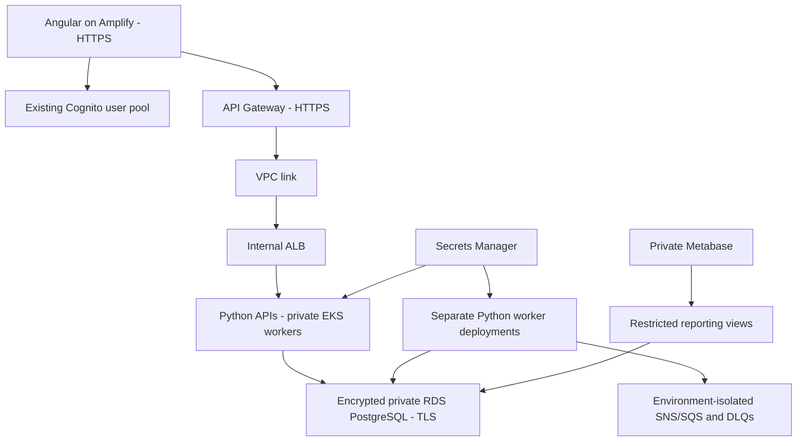

# Step 10 - deploy the existing Python and Angular application in stages

## Current position

Step 09 is complete and cleaned up. You selected **mock checkout for Step 10**, with a payment-provider sandbox afterward. This guide separates what is implemented from what still needs development or cloud verification.

**Step 10A foundation is deployed and verified:** state/bootstrap storage and the approved **56-resource foundation apply** are complete. Terraform added 56, changed/destroyed none; all **23 initial live checks** passed, both workers were Ready, and the post-apply plan reported **no changes**. Foundation state is encrypted/versioned in S3. Step 10C subsequently replaced the operator's changed `/32` address; its post-repair foundation plan also reports no changes. See [the execution guide](10-foundation-deployment.md).

The reviewed foundation permissions were owner-provisioned and CLI-verified before deployment. The subsequent billable apply used the non-root profile and the exact approved binary. See [permission evidence](../evidence/step10-foundation-permissions-applied.json) and [deployment evidence](../evidence/step10-foundation-deployment.json).

The user approved **USD 75**, the 14-day recovery package and immediate deployment instead of the proposed 6 PM start. Actual apply started **18 October at 1:52:45 PM**, with cleanup still targeted for **25 October at 6 PM**, Asia/Colombo. The core model through that cleanup start is **USD 52.41**, before usage/taxes/retention/deletion time. State is retained, final snapshot/release images receive 14 days after actual teardown, and application-secret deletion uses seven-day recovery. No hard cap, automatic cleanup or budget alert is configured. See [the decision record](10-spending-cleanup-retention.md).

**Step 10B is complete:** the private RDS bootstrap passed all five migration chains with TLS 1.3, initialized separate service credentials and runtime Kubernetes Secrets, and seeded four attractions, four ticket tiers and 21 visit slots. Temporary bootstrap IAM/Pod Identity and Kubernetes access were removed; all eleven cleanup checks passed. See the [Step 10B execution guide](10B-private-database.md).

**Step 10C is deployed and verified:** the enabled Helm release runs eight API replicas and seven workers using five digest-pinned images, six scoped workload identities and isolated SNS/SQS infrastructure. All 34 final checks passed; pricing synchronization and duplicate handling passed before and after switching to projection mode. See [Step 10C](10C-services-and-workers.md).

**Steps 10D and 10E are deployed and verified:** 57 routing resources publish Angular through Amplify and 29 exact API Gateway routes through one internal ALB. All 23 public and 22 live routing checks passed. Real administrator/visitor signup and sign-in, role/ownership denials, hosted mock checkout and ticket history passed. Private Metabase now adds three cloud dashboards and eight saved questions, verified after Pod replacement. The hosted check-in → ride usage → SNS/SQS → Analytics flow and temporary-access cleanup passed, including 29 final BI runtime checks; BI Terraform has no changes. The combined planning model is USD 64.41 before exclusions within the USD 75 allowance, with cleanup on 25 October at 6 PM Sri Lanka. This is not a verified bill or enforced cap. See [Step 10D](10D-routing-and-frontend.md) and [Step 10E](10E-hosted-mock-analytics.md). Checkout stays mock; backup restore and later assignment milestones remain.

The assignment requires the entire infrastructure to be reproducible at the viva. We will keep the existing `wonderland-dev-auth` Cognito stack under CloudFormation ownership and reference it. Its template must remain in the repository and deployment rehearsal. Terraform must not create another pool containing a different set of users. The existing local app and its database remain available while the cloud environment is built.

## Checkpoints and exit conditions

| Checkpoint | Work | Evidence required before advancing |
|---|---|---|
| 10A | Tooling, state storage, VPC/EKS/RDS/ECR foundation | Complete: approved 56-resource apply, 23 live checks, two Ready workers, eight healthy system pods, encrypted/versioned state and zero-change post-apply plan |
| 10B | Database bootstrap, roles, secrets, migrations, seed data | Complete: five live migration heads, TLS 1.3, separate runtime roles/secrets, verified seed data and removal of temporary bootstrap access; restore rehearsal remains future work |
| 10C | Service images, workload IAM, supervised workers and messaging | Complete: private Helm revision 2, fifteen ready Pods, six worker identities, verified price synchronization/duplicate handling, empty observed DLQs and zero-change Terraform plans; live poison-message redrive remains reliability rehearsal |
| 10D | Internal ingress, API Gateway, Angular on Amplify | HTTPS public endpoint; complete route map; authentication/ownership/role denials; hosted visitor/admin flow |
| 10E | Hosted Metabase and integration rehearsal | Restricted reporting connection, persistent metadata, timestamped check-in/ride/purchase metrics, access controls, measured delivery delay, teardown/recovery rehearsal |

After the mock cloud flow works, complete the remaining assessed features before the final submission walkthrough: provider sandbox payments, purchase/revenue reporting by tier, available-tier management and password recovery evidence. GitHub delivery is Step 11. Step 12 covers the remaining feature checks, measured reliability/scaling, final report and viva rehearsal. See [the full completion checklist](../ASSIGNMENT_COMPLETION.md).

## 1. Understand the target platform



Foundation defaults: Mumbai, VPC `10.90.0.0/16`, two public subnets, two private compute subnets, two isolated database subnets, one NAT gateway, EKS 1.35 in standard support, two t3.medium workers, one db.t4g.small PostgreSQL 16 instance, five immutable ECR repositories and five empty service-secret containers. The database administrator password is generated and managed by RDS/Secrets Manager; Terraform does not receive a password value. RDS supports this integration as described in [AWS's password management guide](https://docs.aws.amazon.com/AmazonRDS/latest/UserGuide/rds-secrets-manager.html).

Two workers use four vCPUs. Fresh checks on 18 October 2026 found the regional Standard On-Demand quota is now **16**, with zero current usage; the older five-vCPU reading is superseded. All 17 checked quota comparisons and four availability checks passed, and the foundation plan was refreshed and reviewed with the same 56 additions and no planned-value changes. See [the pre-deployment walkthrough](10-pre-deployment-checks.md). Recheck if conditions change before apply. This default is a **demo cost compromise**, not full high availability: RDS is Single-AZ, there is one NAT gateway, and managed node-group capacity is fixed. Spanning subnets and running multiple pods does not prove resilience. HPA, metrics collection, node scaling and outage tests still need implementation/measurement. A production option with multi-AZ RDS and per-AZ NAT requires a separate cost decision.

Private service traffic in the starter chart uses HTTP. Public Gateway/Amplify endpoints and the RDS connection must use TLS. Internal TLS, ingress certificates and network policies must be decided and verified in 10D before claiming encryption across every hop. The foundation alone does not secure or publish an application route.

## 2. Know what Terraform and Helm own

| Location | Ownership/status |
|---|---|
| `infra/terraform/bootstrap/` | State bucket, versioning, encryption, public-access block, TLS-only bucket policy |
| `infra/terraform/foundation/` | VPC/subnets/NAT/security groups, EKS/worker roles/access entry/logs/Pod Identity agent, RDS, ECR, service-secret containers |
| `deploy/helm/wonderland/` | Internal API/worker Deployments, ServiceAccounts, Services, API disruption budgets and non-secret configuration; disabled until prerequisites exist |
| `infra/auth/cognito.yaml` | Existing Cognito stack, retained under CloudFormation |
| `infra/events/sns-sqs.json` | Existing development messaging stack; preserve while building cloud messaging deliberately |
| Later platform/edge/frontend roots | Still to implement: workload permissions, environment-isolated event transport, ingress/controller, API Gateway, Amplify and operational configuration |

Do not run two consumers with different local/cloud databases against the same SQS queue: either could acknowledge an event before the other sees it. Cloud messaging needs deliberate environment isolation and replay/bootstrap. Do not blindly point all cloud workers at development queues or mark cloud Admission delivery complete because the local mock pipeline works.

## 3. Tool setup and one local verification command

Tools installed under the ignored `.local/tools/` directory:

- Terraform **1.16.6**, downloaded from official HashiCorp releases; archive SHA-256 checked.
- Helm **4.3.1**, downloaded from official Helm distribution; archive SHA-256 checked.
- HashiCorp AWS provider **6.66.0** and random provider **3.7.2**, installed with signed provider verification. Both roots have dependency lock files to commit.
- Existing kubectl **1.35.9** remains the client for the target cluster.

To recreate the pinned tools on another Windows machine, run `scripts/install-deployment-tools.ps1`. It verifies the pinned archive hashes before execution.

Run in PowerShell from `D:\Courses\Microservices`:

```powershell
.\scripts\check-deployment.ps1
```

It runs Terraform formatting, initializes providers in separate local validation data directories with the backend disabled, validates both roots, runs **6 mock-provider Terraform cases**, lints Helm for Kubernetes 1.35, and runs **17 chart/permission-guard pytest cases**. It never applies AWS or contacts a Kubernetes cluster. Provider initialization may download packages.

Tests cover private/encrypted RDS, TLS-required database parameters, retained snapshots/deletion safeguards, restricted Kubernetes API access, rejection of root and unreviewed capacity, standard-support version selection, immutable images, private Services, secret references, non-root containers and explicitly labelled mock configuration.

The file `deploy/helm/tests/render-values.yaml` is test data only. Its `example.invalid` images cannot run. Do not use it with `helm install`. The chart's default `enabled: false` produces no workloads. It does not create database schemas, Kubernetes Secrets, AWS Pod Identity associations, migrations, external routes or Metabase.

## 4. Verify your non-root AWS identity

```powershell
. .\scripts\aws-common.ps1
& $LocalAws sts get-caller-identity --profile wonderland-feasibility
```

Expected account: `708919751353`; role session: `AWSReservedSSO_WonderlandFeasibility_42305b7f1177de77/chamindu`. If expired:

```powershell
& $LocalAws sso login --profile wonderland-feasibility
```

Complete password/MFA/authorization directly in AWS. No access keys belong in Terraform variables, Helm values, container images, source files or chat. Cognito administrator membership is separate from AWS deployment access.

The current permission set can read account inventory, manage state storage, perform Step 09 operations and now has the reviewed Step 10 foundation grants. The owner update and account provisioning succeeded, and the CLI role matches the reviewed policy. Some Step 09 EC2/ELB operations and new NAT/EIP operations are Mumbai-wide; API Gateway access covers regional paths. The [foundation permission walkthrough](10-foundation-permissions.md) records effective scopes, verification, the one-week cost model and owner helper. Policy validation and a dry-run check do not prove every downstream apply permission or available quota.

## 5. Review the first real bootstrap plan

```powershell
.\scripts\plan-deployment-bootstrap.ps1
```

This verifies account/non-root identity and writes:

```text
.local/deployment/bootstrap.tfplan
.local/deployment/bootstrap-plan.json
```

The approved and executed bootstrap plan contained **5 additions, 0 changes, 0 deletions**. It is complete; a fresh plan now reports no changes. The five resources were:

1. S3 bucket `wonderland-tfstate-708919751353-ap-south-1`.
2. Bucket versioning, enabled.
3. AES256 server-side encryption.
4. All four public-access blocks.
5. A policy denying non-TLS access.

There is no EKS, RDS, NAT gateway, load balancer or application deployment in this bootstrap plan. The bucket has `prevent_destroy = true` and `force_destroy = false`; normal application teardown must not remove its state/history. S3 storage, versions and requests are billable. This is a persistent shared deployment prerequisite, not a temporary Step 09 resource. Use current [S3 pricing](https://aws.amazon.com/s3/pricing/) for the selected region; no credit balance or zero-cost guarantee is assumed.

Read a saved plan with:

```powershell
& .\.local\tools\terraform\terraform.exe -chdir=infra/terraform/bootstrap show "$PWD\.local\deployment\bootstrap.tfplan"
```

Recreate/review a plan after changing source or credentials. Do not apply a stale binary plan.

## 6. Prepare state permissions, then apply only after approval

The reviewed `infra/terraform/bootstrap/operator-policy.json` adds only writes/configuration for this exact bucket, Get/Put on `demo/*` state objects and deletion of `demo/*.tflock` lock files. It grants no bucket deletion or state-version deletion. Existing managed ReadOnlyAccess supplies reads/listing. IAM Access Analyzer validation returned zero findings; that validates syntax and known policy issues, not every downstream provisioning permission.

An authorized owner/Identity Center administrator can upload **both** `operator-policy.json` and `apply-permissions-cloudshell.sh` from the bootstrap directory into the same Mumbai CloudShell session. After approval for this access change:

```bash
ls -l operator-policy.json apply-permissions-cloudshell.sh
bash -n apply-permissions-cloudshell.sh
bash apply-permissions-cloudshell.sh operator-policy.json 2>&1 | tee step10-state-permissions.log
```

The helper verifies account/permission-set name, checks the exact allowed state grants, preserves all other inline statements, validates the merged policy and reprovisions account 708919751353. It does not deploy infrastructure. Capture the exact error if it fails; do not replace the permission set with AdministratorAccess. The approved update has now been applied and reprovisioned. The source policy SHA-256 is `395d782b32b88ad8540060359102eec5fb95936471df0c4151939bf26177b3fa`; use the current helper, whose corrected guard accepts both single and list action forms. The initial guard error made no permission change; four local guard tests now cover preservation and rejection of broader grants.

The following apply sequence is for reproduction, not a request to repeat the completed apply. After provisioning succeeds, verify the effective role policy and renew the SSO session if needed. Regenerate the bootstrap plan, confirm the same five additions, and only then apply the specifically approved plan:

```powershell
. .\scripts\aws-common.ps1
$env:AWS_PROFILE = 'wonderland-feasibility'
$env:AWS_SDK_LOAD_CONFIG = '1'
& .\.local\tools\terraform\terraform.exe -chdir=infra/terraform/bootstrap apply "$PWD\.local\deployment\bootstrap.tfplan"
```

The bootstrap root initially uses local state. Its state has now been migrated into `demo/bootstrap/terraform.tfstate`, with encryption, versioning and lock-file support verified. The ignored local backup is retained. `scripts/migrate-bootstrap-state.ps1` reproduces that migration using the tracked backend templates; it generates an ignored `bootstrap/backend.tf` so a first deployment can still start before the bucket exists. Application foundation state uses a separate key. Never lose either ownership record or reapply a stale pre-migration plan.

## 7. Initialize foundation remote state and create its live plan

The bucket now exists. For the current account, `scripts/plan-deployment-foundation.ps1` resolves the permanent non-root SSO role, checks the current public IPv4, writes ignored JSON variables, initializes S3 state and saves a plan without applying it. It has already run successfully. Do not keep a second `terraform.tfvars` alongside that generated JSON file.

For a manual setup on another machine, only after the state bucket exists:

```powershell
. .\scripts\aws-common.ps1
$env:AWS_PROFILE = 'wonderland-feasibility'
$env:AWS_SDK_LOAD_CONFIG = '1'
Copy-Item infra/terraform/foundation/backend.hcl.example .local/deployment/foundation-backend.hcl
& .\.local\tools\terraform\terraform.exe -chdir=infra/terraform/foundation init -reconfigure "-backend-config=$PWD\.local\deployment\foundation-backend.hcl"
Copy-Item infra/terraform/foundation/terraform.tfvars.example infra/terraform/foundation/terraform.tfvars
```

Edit the ignored `terraform.tfvars` with the permanent SSO role ARN and your current public IPv4 `/32`. The sample role path and documentation-only IP are placeholders, not working deployment values. Resolve your role with `iam get-role`; do not put the temporary STS session ARN into EKS. Confirm the address after a VPN/network change. Then create a live foundation plan:

```powershell
& .\.local\tools\terraform\terraform.exe -chdir=infra/terraform/foundation plan -input=false "-out=$PWD\.local\deployment\foundation.tfplan"
```

Backend configuration enables `use_lockfile = true`. HashiCorp recommends bucket versioning for recovery and documents S3 locking in the [S3 backend guide](https://developer.hashicorp.com/terraform/language/backend/s3). Keep `.terraform.lock.hcl` files in Git; never commit `.terraform/`, state, plan files, actual tfvars or credentials.

The permission, quota, cost and retention reviews were followed by explicit billable deployment approval. The exact 56-resource plan was applied and verified; see [the execution guide](10-foundation-deployment.md). The actual-start core estimate is USD 52.41 through the unchanged cleanup start, before exclusions and later platform additions. Do not rerun the historical saved plan; a fresh post-apply plan reports no changes. Later stages need fresh plans and scope/cost review.

## 8. Database and secrets work in 10B

Do not copy `deploy/local/postgres/*.sql` into the cloud: those scripts intentionally contain local demo passwords. Build a cloud bootstrap Job that retrieves the RDS administrator secret through a temporary, narrowly scoped workload role, connects with `sslmode=verify-full` and the AWS RDS CA bundle, and creates separate schema-owner users plus restricted reporting/Metabase roles. Generate credentials outside Terraform state and store them in the service secret containers.

Next, deliver credentials to the workload using the selected secrets integration, run each service's Alembic migrations and idempotent seed routines, and verify schema isolation. The API pods must never receive the RDS administrator secret. Database bootstrap must be explicit and restart-safe; no startup migration loop in every API replica. RDS snapshots, role recovery and secret rotation need a documented restore procedure.

## 9. Images and workloads in 10C

Build the five Linux/amd64 images from the existing Dockerfiles, push unique tags to the new environment's ECR repositories, then deploy repository digests. Complete AWS Pod Identity associations for separate API/worker ServiceAccounts; installing the agent alone grants no workload permission. AWS describes the trust and temporary-credential flow in its [Pod Identity documentation](https://docs.aws.amazon.com/eks/latest/userguide/pod-identities.html).

Create environment-isolated topics/queues/DLQs and scoped publisher/consumer grants. Preserve the older development messaging stack. Port and verify Admission's transport rather than describing its direct local database feed as SNS/SQS. Publish the initial pricing snapshot and compare versions before switching Booking from HTTP pricing to projection mode. Supervise booking expiry, outbox relays and consumers independently; record heartbeat/freshness and retry/DLQ behavior.

Only enable the starter chart with real image digests, precreated secrets and the actual frontend origin after its prerequisites exist. Extend it with migration Jobs, secret integration, policies/monitoring and the reviewed operational resources. Current chart rendering is not a live rollout.

## 10. Routing, frontend, BI and full verification in 10D/10E

Create a private ingress/controller route map for every public API path, using ALB IP targets and automatic reconciliation rather than Step 09's manually registered NodePort. Keep private health/admin/debug/backend-only endpoints out of public routing. Apply and test JWT authentication, Python ownership checks and administrator groups. Resolve the internal TLS approach before claiming every sensitive hop is encrypted.

Build Angular with a generated public `app-config.json` containing only the Gateway base URL and Cognito public IDs. Host it through Amplify, configure SPA rewrites and verify direct navigation/reload. Configure CORS for the actual HTTPS origin. Do not put database credentials or AWS keys into browser assets. Git-linked deployments are completed in Step 11, with a real repository the user owns.

Deploy Metabase with a persistent application database, an aggregate-only reporting user and administrator-only access. Provide secure access by authenticated routing or a private, deliberate operator workflow. Do not expose a public unauthenticated BI instance. Add mock purchase/revenue facts and charts in 10E; arrivals and ride charts alone do not satisfy all monitoring requirements. After provider sandbox integration in Step 12A, validate the corresponding provider-backed facts and charts separately.

Record a hosted walkthrough: visitor signup/login, tier/date/slot booking, mock checkout and ticket reference, own history, admin attraction/pricing changes, simulated gate entry and ride usage, and connected analytics. Verify another user cannot read the booking and a visitor cannot perform administrator actions. Label all mock transactions and simulated admissions honestly.

## 11. Cleanup and retention

Choose retention before applying. Delete external routes and Helm workloads/controller-created ALBs before EKS/network teardown. Confirm outbox/queue handling and backups before deleting data resources. RDS deletion protection defaults on and a final snapshot is required; snapshots/backups, secrets in recovery, ECR images and state versions can retain costs after compute deletion. ECR refuses force deletion while images remain. These safeguards require deliberate cleanup, not changing flags automatically after an error.

Keep identity, state and user data deliberately according to the agreed plan. Record retained resources and delayed billed usage. A successful `terraform destroy` does not prove all retained artifacts have zero cost. Verify live resources and compare against saved IDs as we did in Step 09.

Operational capacity note: the current two workers use four vCPUs, leaving insufficient room under the previously observed five-vCPU quota for a normal extra t3.medium during a rolling node update. Review/increase quota or deliberately choose and test another update strategy before node upgrades; do not claim rolling-update readiness from the initial deployment plan.
